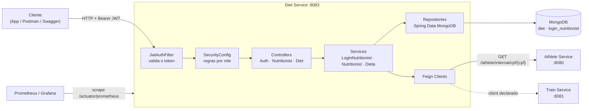
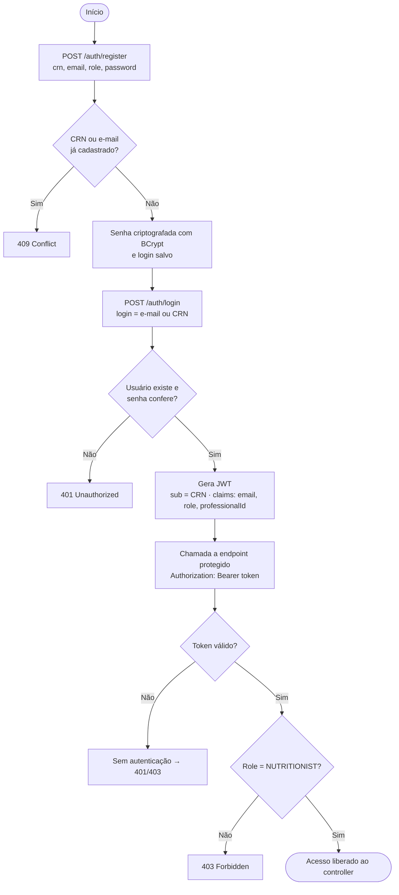
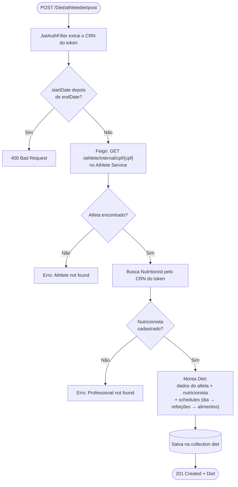
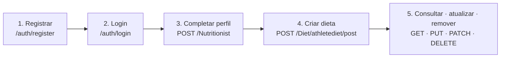
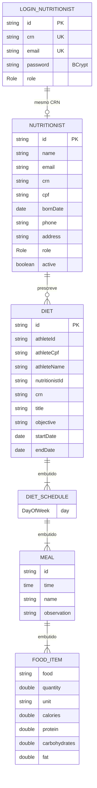

# 🥗 TrainDay — Diet Service (`microserviceDiet`)

Microsserviço de **dietas** da plataforma **TrainDay**. Permite que nutricionistas se cadastrem, se autentiquem e montem planos alimentares semanais (dias, refeições e alimentos com macros) para atletas, que são validados no serviço de atletas via Feign.


---

## 📑 Sumário

- [Visão geral](#-visão-geral)
- [Arquitetura e fluxogramas](#-arquitetura-e-fluxogramas)
- [Stack](#-stack)
- [Estrutura do projeto](#-estrutura-do-projeto)
- [Como executar](#-como-executar)
- [Autenticação e autorização](#-autenticação-e-autorização)
- [Endpoints](#-endpoints)
- [Modelo de dados](#-modelo-de-dados)
- [Testes](#-testes)
- [Observabilidade](#-observabilidade)

---

## 🔎 Visão geral

| Item | Valor |
|---|---|
| Nome da aplicação | `trainDiet` |
| Porta | `8083` |
| Banco de dados | MongoDB |
| Autenticação | JWT (HS256), expiração de 24h |
| Documentação da API | Swagger UI em `/swagger-ui.html` |
| Perfil com acesso | `NUTRITIONIST` |

**Responsabilidades do serviço:**

- Cadastro e login de nutricionistas (identificados pelo **CRN**).
- Gestão do perfil do nutricionista.
- CRUD de dietas vinculadas a um atleta (identificado pelo **CPF**).
- Validação da existência do atleta no **Athlete Service** via OpenFeign.

---

## 🧭 Arquitetura e fluxogramas

### Visão de componentes



### Fluxo de autenticação e acesso



### Fluxo de criação de dieta



### Jornada completa de uso



> ⚠️ O passo 3 é obrigatório antes de criar dietas: a criação busca o `Nutritionist` pelo CRN do token.

---

## 🛠️ Stack

| Camada | Tecnologia |
|---|---|
| Linguagem | Java 21 |
| Framework | Spring Boot 3.4.1 |
| Segurança | Spring Security + JWT (jjwt 0.11.5) + BCrypt |
| Banco | Spring Data MongoDB |
| Integração entre serviços | Spring Cloud OpenFeign (2024.0.0) |
| Documentação | springdoc-openapi 2.8.8 (Swagger UI) |
| Métricas | Actuator + Micrometer Prometheus |
| Configuração | dotenv (`.env`) |
| Testes | JUnit 5, Mockito, Spring Security Test |
| Qualidade | JaCoCo 0.8.11 + SonarCloud |
| Build | Maven (wrapper incluso) |

---

## 🗂️ Estrutura do projeto

```text
src
├── main
│   ├── java/com/trainday/microserviceDiet
│   │   ├── MicroserviceDietApplication.java
│   │   ├── api
│   │   │   ├── Controller        # AuthController, NutritionistController, DietController
│   │   │   └── DTO               # request/response (records)
│   │   ├── application/service   # DietaService, NutritionistService, LoginNutritionistService
│   │   ├── Repository            # DietRepository, NutritionistRepository, LoginNutritionistRepository
│   │   ├── models                # Diet, DietSchedule, Meal, FoodItem, Nutritionist, LoginNutri, enums/Role
│   │   └── infra
│   │       ├── Config            # SecurityConfig, FeignConfig, OpenConfig
│   │       ├── Security          # JwtAuthFilter, SwaggerConfig, GlobalExceptionHandler, UserDetailImpl
│   │       ├── client            # AthleteClient, AthleteTrainClient (Feign)
│   │       └── service           # JwtService, LoginUserDetailsService
│   └── resources/application.properties
└── test                          # testes unitários espelhando a estrutura de main
```

---

## 🚀 Como executar

### Pré-requisitos

- JDK 21
- MongoDB acessível (local ou Atlas)
- (Opcional) **Athlete Service** rodando em `localhost:8080`, necessário para criar dietas

### 1. Clonar

```bash
git clone https://github.com/Danielpernnasc/microserviceDiet.git
cd microserviceDiet
```

### 2. Configurar variáveis de ambiente

Crie um arquivo `.env` na raiz (a aplicação o importa via `spring.config.import`):

```properties
MONGO_URI=mongodb://localhost:27017/trainday_diet
JWT_SECRET=troque-por-uma-chave-longa-com-no-minimo-32-caracteres
```

> 🔐 **Nunca versione o `.env`.** Adicione-o ao `.gitignore` e mantenha apenas um `.env.example` sem valores reais.

### 3. Subir a aplicação

```bash
./mvnw spring-boot:run
```

A API ficará em `http://localhost:8083` e o Swagger em `http://localhost:8083/swagger-ui.html`.

### Integrações esperadas

| Serviço | URL configurada | Uso |
|---|---|---|
| Athlete Service | `http://localhost:8080` | `GET /athlete/internal/cpf/{cpf}` — valida o atleta ao criar a dieta |
| Train Service | `http://localhost:8081` | Client declarado (`AthleteTrainClient`) para `GET /train/internal/cpf/{cpf}` |

O `FeignConfig` repassa o header `Authorization` da requisição original para as chamadas Feign.

---

## 🔐 Autenticação e autorização

- Login por **e-mail ou CRN** + senha (BCrypt).
- O token JWT (HS256) leva `sub = CRN` e as claims `crn`, `email`, `professionalId` e `role`. Expira em **24h** (`jwt.expiration=86400000`).
- O `JwtAuthFilter` valida o token e injeta a authority `ROLE_<role>` no contexto de segurança.
- Rotas públicas: `/auth/**`, `/swagger-ui/**`, `/v3/api-docs/**`, `/actuator/**`.
- Todas as rotas de `/Nutritionist` e `/Diet` exigem a role **`NUTRITIONIST`**.

Exemplo de uso do token:

```bash
curl -H "Authorization: Bearer <TOKEN>" http://localhost:8083/Nutritionist/ListNutri
```

Roles existentes (`Role`): `ATHLETE`, `PERSONAL_TRAINER`, `DOCTOR`, `NUTRITIONIST`, `LAB_TECHNIC`, `ADMIN`.

---

## 📡 Endpoints

### Auth — `/auth` (público)

| Método | Rota | Descrição |
|---|---|---|
| `POST` | `/auth/register` | Cria o login (CRN, e-mail, role, senha). `409` se CRN/e-mail já existem |
| `POST` | `/auth/login` | Autentica por e-mail ou CRN e retorna o JWT |

```json
// POST /auth/register
{ "crn": "CRN3-12345", "email": "nutri@email.com", "role": "NUTRITIONIST", "password": "********" }

// POST /auth/login
{ "login": "nutri@email.com", "password": "********" }
```

### Nutritionist — `/Nutritionist` (role `NUTRITIONIST`)

| Método | Rota | Descrição |
|---|---|---|
| `POST` | `/Nutritionist` | Cria o perfil do nutricionista logado (CRN vem do token). `409` se já existir |
| `GET` | `/Nutritionist/searchnutritionist/{crn}` | Busca um nutricionista pelo CRN |
| `GET` | `/Nutritionist/ListNutri` | Lista todos os nutricionistas |
| `PUT` | `/Nutritionist/UpdateNutri` | Atualiza o perfil do nutricionista logado |
| `PATCH` | `/Nutritionist/PatchNutri` | Atualização parcial do perfil |

```json
// POST /Nutritionist
{
  "name": "Maria Souza",
  "bornDate": "1990-05-20",
  "cpf": "00000000000",
  "phone": "11999999999",
  "address": "São Paulo - SP"
}
```

### Diet — `/Diet` (role `NUTRITIONIST`)

| Método | Rota | Descrição |
|---|---|---|
| `POST` | `/Diet/athletediet/post` | Cria uma dieta para um atleta (valida via Athlete Service). Retorna `201` |
| `GET` | `/Diet/athletediet/get/{cpf}` | Lista as dietas do atleta pelo CPF |
| `PUT` | `/Diet/athletediet/put/{cpf}` | Atualiza a dieta do atleta (exige `crn` no corpo) |
| `PATCH` | `/Diet/athletediet/patch/{cpf}` | Atualização parcial (só campos informados) |
| `DELETE` | `/Diet/athletediet/delete/{cpf}` | Remove a dieta e retorna o registro removido |

```json
// POST /Diet/athletediet/post
{
  "athleteCpf": "00000000000",
  "title": "Bulking",
  "objective": "Ganho de massa magra",
  "startDate": "2026-12-01",
  "endDate": "2027-03-01",
  "schedules": [
    {
      "weekday": "MONDAY",
      "meals": [
        {
          "time": "07:30",
          "name": "Café da manhã",
          "observation": "Beber 500 ml de água antes",
          "foods": [
            { "food": "Ovo cozido", "quantity": 3, "unit": "un",
              "calories": 234, "protein": 19, "carbohydrates": 1.5, "fat": 15 }
          ]
        }
      ]
    }
  ]
}
```

> `weekday` usa os nomes de `java.time.DayOfWeek` (`MONDAY`…`SUNDAY`, case-insensitive) e `time` segue o formato `HH:mm`.

### Tratamento de erros

O `GlobalExceptionHandler` converte `ResponseStatusException` e `BadCredentialsException` em respostas com o status adequado, `DuplicateKeyException` em `409` e demais exceções em `500`.

---

## 🧬 Modelo de dados



`DietSchedule`, `Meal` e `FoodItem` ficam **embutidos** no documento `diet` (MongoDB), sem collections próprias.

---

## 🧪 Testes

A branch `testeUnitario` cobre as camadas do serviço com testes unitários (**63 casos**), usando **JUnit 5**, **Mockito** e **Spring Security Test**:

| Camada | Classes testadas |
|---|---|
| Controllers | `AuthController`, `NutritionistController`, `DietController` |
| Services | `DietaService`, `NutritionistService`, `LoginNutritionistService` |
| Segurança / infra | `JwtAuthFilter`, `JwtService`, `SecurityConfig`, `SwaggerConfig`, `FeignConfig`, `GlobalExceptionHandler`, `UserDetailImpl`, `LoginUserDetailsService` |
| Models | `Role` |

```bash
# rodar os testes
./mvnw test

# testes + relatório de cobertura JaCoCo
./mvnw clean verify
# relatório: target/site/jacoco/index.html
```

O projeto também está configurado para análise no **SonarCloud** (`sonar-maven-plugin`).

---

## 📊 Observabilidade

Endpoints do Actuator expostos: `health`, `info`, `metrics` e `prometheus`.

| Recurso | URL |
|---|---|
| Health (com detalhes) | `http://localhost:8083/actuator/health` |
| Métricas Prometheus | `http://localhost:8083/actuator/prometheus` |

Todas as métricas recebem a tag `application=register-diet`, útil para filtrar dashboards no Grafana.

---

## 👤 Autor

**Daniel** — [@Danielpernnasc](https://github.com/Danielpernnasc)
